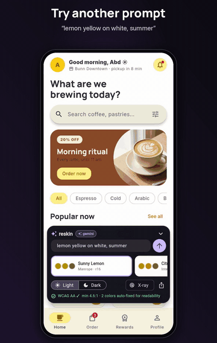
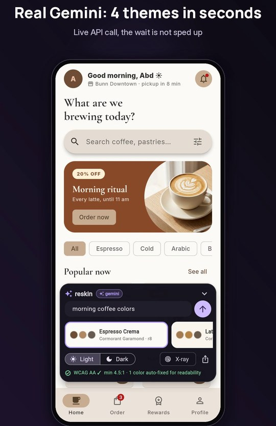
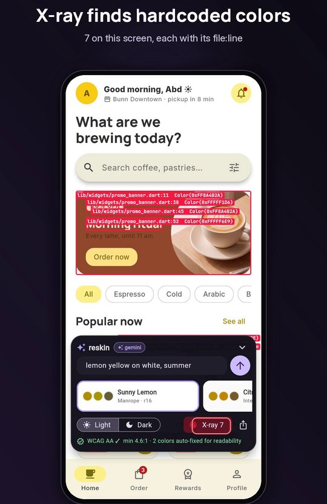
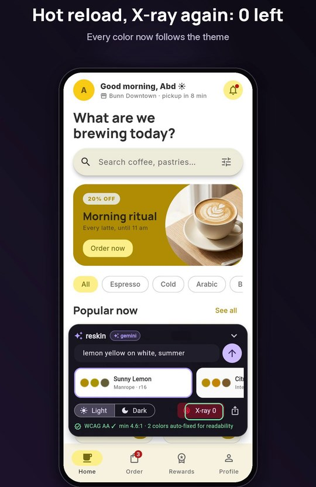
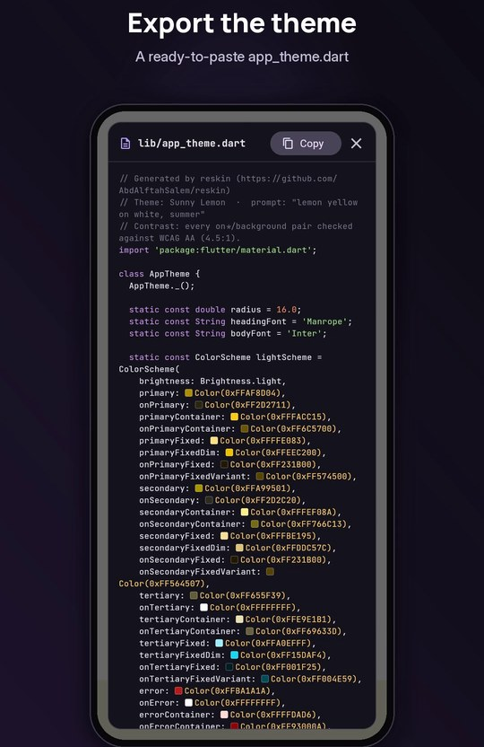
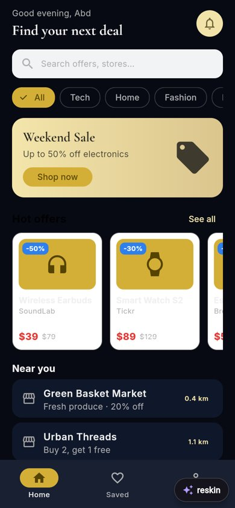
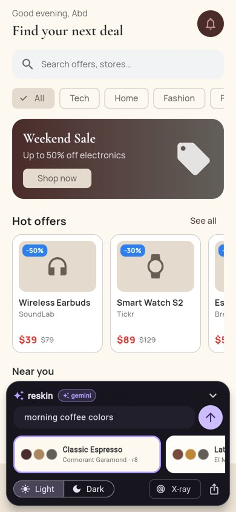
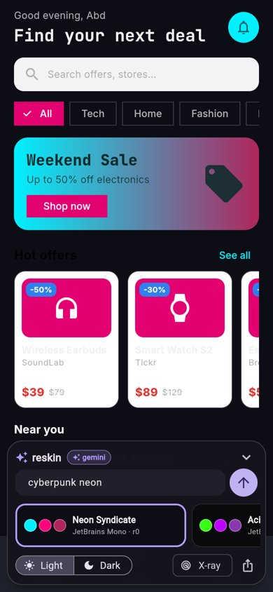

# reskin

**Re-theme your *running* Flutter app from a prompt, and X-ray every hardcoded color.**

Type *"Ramadan night, gold on navy"* and your real screens restyle on the spot. Swipe
between variants. Flip to Dark, turn on X-ray, and every widget whose color ignores the
theme is outlined in red with its `file:line`. Those are the colors that break dark mode.
Then let an AI agent fix them through `reskin-mcp`, and export a clean `app_theme.dart`.

<p align="center">
  <a href="docs/media/reskin_showcase.mp4"></a>
  <br>
  <a href="docs/media/reskin_showcase.mp4"><b>▶ Watch the full demo (74s)</b></a>
</p>

| "morning coffee colors" (live Gemini) | X-ray: 7 hardcoded colors | After `reskin-mcp fix`: 0 | Export |
|---|---|---|---|
|  |  |  |  |

> Debug-only dev tool. In release/profile builds `Reskin.builder()` returns your app
> untouched.

**AI themes on the example app** (real Gemini answers, see [docs/LOG.md](docs/LOG.md)):

| "Ramadan night, gold on navy" (dark) | "morning coffee colors" | "cyberpunk neon" |
|---|---|---|
|  |  |  |

## Quick start

```yaml
# pubspec.yaml
dependencies:
  reskin:
    git: https://github.com/AbdAlftahSalem/reskin.git
```

```dart
import 'package:reskin/reskin.dart';

MaterialApp(
  theme: lightTheme,
  darkTheme: darkTheme,
  builder: Reskin.builder(theme: lightTheme, darkTheme: darkTheme), // one line
  home: const HomePage(),
);
```

Run in debug. Tap the **reskin** pill (bottom right):

- **Prompt**: describe a vibe (`gold on navy`, `minimal fintech`, `playful, very round`).
- **Carousel**: swipe between variants. *Original* is your own theme.
- **Light / Dark**: force either mode.
- **X-ray**: red boxes on every hardcoded color, labelled `lib/home/offer_card.dart:19  Colors.white`.
  The badge counts distinct places in code.
- **Export**: shows `lib/app_theme.dart` with a Copy button, and calls `onExport(code)`.

## Theme generation: AI first, offline fallback

With a key, a real model designs the theme; without one (or when the call fails) the
built-in offline generator does.

```
prompt ─▶ Gemini (default) / OpenAI ─▶ strict JSON validation ─▶ Material 3 schemes ─▶ WCAG AA fixes ─▶ applied
              │ error · timeout · bad JSON · no key
              └──────────────▶ offline generator ─▶ same schemes + checks   (panel badge: "offline")
```

**What the model returns.** One call asks for 4 variants as structured JSON (Gemini
`responseSchema`, OpenAI strict `json_schema`):

```json
{"variants":[{"name":"Classic Espresso",
  "light":{"primary":"#6F4E37","secondary":"#A07C5B","background":"#FDF7F0","surface":"#F8F0E8"},
  "dark": {"primary":"#D9B89D","secondary":"#BFA287","background":"#2E241E","surface":"#3A2F29"},
  "headingFont":"Cormorant Garamond","bodyFont":"Inter","radius":8}]}
```

The model reads meaning, not keywords: *"morning coffee colors"* gives espresso browns on
cream, with variants named "Classic Espresso", "Creamy Latte", "Morning Brew" and "Cozy Cafe".
Prompts in other languages work too (an Arabic prompt gets Arabic variant names). Real results for five prompts are in [docs/LOG.md](docs/LOG.md).

**What reskin does with it.**

1. **Validates strictly** (`parseAiVariants`): every variant needs a name and a valid
   `light.primary` hex; any other color that is present must be valid hex or the variant is
   dropped; `radius` must be a number (clamped 0–32); fonts must look like family names and,
   if you pass `fonts:`, be on your list (otherwise the app keeps its font). Nothing usable left
   → `ReskinResponseException` → fallback.
2. **Builds full schemes**: the model's primary, secondary, background (`surface`) and card
   color (`surfaceContainerLow`) are used as given; every other Material 3 role comes from the
   primary's tonal palette. A missing dark palette is derived.
3. **Fixes contrast**: `primary`/`secondary` used as text or icons on the page must reach 3:1
   (darkened or lightened, same hue), and every `on*` text pair must reach WCAG AA 4.5:1.
   Neon cyan on white becomes a deeper cyan; it is never trusted as-is.
4. **Falls back** to the offline generator on any HTTP error, network error, timeout
   (20 s per call, 25 s overall), blocked/empty answer or failed validation. The panel badge
   turns amber **offline** and a line says why (`API key rejected (401)`, `timed out after 20s`,
   `bad answer: …`). `controller.usedFallback` / `fallbackReason` / `source` say the same in code.

### Passing a key (debug only)

Use **your own** key, on **debug runs only**:

```bash
flutter run --dart-define=RESKIN_GEMINI_KEY=$GEMINI_API_KEY     # Gemini (default)
flutter run --dart-define=RESKIN_OPENAI_KEY=$OPENAI_API_KEY     # or OpenAI
```

`Reskin.builder()` picks it up by itself (`ReskinProviders.fromEnvironment()`): Gemini when
`RESKIN_GEMINI_KEY` is set, else OpenAI, else offline. Optional: `RESKIN_GEMINI_MODEL`
(default `gemini-flash-lite-latest`), `RESKIN_OPENAI_MODEL` (default `gpt-4o-mini`),
`RESKIN_GEMINI_BASE_URL` / `RESKIN_OPENAI_BASE_URL` for your own proxy. Or build it yourself:

```dart
Reskin.builder(
  theme: lightTheme,
  darkTheme: darkTheme,
  provider: GeminiThemeProvider(
    apiKey: const String.fromEnvironment('RESKIN_GEMINI_KEY'),
    fonts: ['Inter', 'Manrope', 'El Messiri'], // only fonts your app has
  ),
)
```

> **Never ship a key.** A `--dart-define` value is compiled into the binary, so never pass
> one to `flutter build` for a release, never commit it, and keep it out of CI logs.
> `ReskinProviders` returns the offline provider outside debug builds, and `Reskin.builder()`
> is a no-op in release, but the key would still be inside a release binary if you defined it
> there. For anything shared, put the key behind your own server and point `baseUrl` at it.

| Provider | Key | Notes |
|---|---|---|
| `GeminiThemeProvider` | yours | Default AI path. `gemini-flash-lite-latest` (about 2 s per call on a free AI Studio key), `responseSchema`, one retry on 429/503, `thinkingBudget: 512` on Flash models. Pass `model: 'gemini-flash-latest'` for richer palettes (5–8 s). `baseUrl` + `headers` for a proxy. |
| `OpenAIThemeProvider` | yours | Chat Completions with strict `json_schema` (`structuredOutputs: false` for servers that only know JSON mode). `baseUrl` for any compatible server. |
| `OfflineThemeProvider` | none | Fallback, and the default with no key. Deterministic: same prompt, same themes. |
| your own | | implement `ReskinThemeProvider.generate(ReskinPrompt)` |

### The offline fallback

No network, no key, deterministic. It understands about 90 English color words, 60 mood
words (`ramadan`, `coffee`, `morning`, `calm`, `medical`, `students`, `cyberpunk`, `luxury`…),
**Arabic color and mood words** too (gold, navy, green, olive, burgundy, brown, beige, Ramadan,
coffee, morning, calm, medical…, with common prefixes, feminine forms and spelling variants
normalized), the pattern **"X on Y"** (X accent, Y background; its Arabic form works as well),
and `round` / `sharp` / `serif` / `mono`.
Words it does not know still give a stable color derived from the text. It is a keyword
dictionary, not a model: it will not understand a sentence it has no words for.

A logo works too: `controller.generate(ReskinPrompt.image(AssetImage('assets/logo.png')))`
(the seed comes from `ColorScheme.fromImageProvider`, the AI then designs around it).

Fonts are family names. Bundle them, or pass `fontResolver: (family, base) => GoogleFonts.getTextTheme(family, base)`.

### Contrast (WCAG AA)

Every generated scheme goes through `makeReadable()`: `primary`/`secondary` must reach 3:1 against
the page, and every `on*` text color 4.5:1 against its background. Failing colors keep their hue
and are moved toward black or white until they pass. The panel shows the result under the
controls, for example `WCAG AA ✓ min 4.5:1 · 2 colors auto-fixed for readability`
(`ReskinTheme.fixesFor(brightness)` has the count).

## How X-ray works

1. reskin reads the explicit colors of supported widgets under the live theme.
2. It rebuilds the subtree once with a **probe theme** in which every color role is shifted
   to a different value (same layout and fonts), reads the colors again, and restores the
   real theme. The probe is built and reverted between frames, so it never reaches the screen.
3. A color that did not change cannot come from the theme, so it is hardcoded. Theme-derived
   colors (`colorScheme.primary.withValues(alpha: .1)`, lerps) move with the probe and are not flagged.
4. `file:line` comes from Flutter's widget-creation tracking (`--track-widget-creation`, on by
   default in debug), the same data the widget inspector uses. Widgets built inside
   `package:flutter` are skipped, so a `Container` is reported once, not again for its inner
   `DecoratedBox`.

**Detected:** `Container` (color, decoration color/border/gradient), `DecoratedBox`, `ColoredBox`,
`Text` (style color/background), `Icon`, `ImageIcon`, `Card`, `Material`, `CircleAvatar`,
`Divider`, `Chip`, `AppBar`, `Scaffold`, `FloatingActionButton`, progress indicators, `Badge`.
Add your own widgets with `XrayScanner(extraExtractors: [...])`.

**Not detected (yet):** colors inside `ButtonStyle`/`WidgetStateProperty`, `CustomPainter`,
images, `TextSpan` children beyond the root span, shadows, and colors set in your own
component themes (those are theme-level, by design). Without creation tracking (profile
builds) findings show the widget type instead of `file:line`. A hardcoded color that is
conditional on brightness (`isDark ? Colors.white : Colors.black`) is flagged, because it will
not follow a rebrand.

## reskin-mcp: let the agent fix the red ones

`mcp/` is a small Node/TypeScript MCP server with three tools: `xray` (static scan of
`lib/`, with a suggested `Theme.of(context).colorScheme.<role>` per hit), `apply_theme` and
`export_theme` (through the app's VM service). See [mcp/README.md](mcp/README.md).

```
lib/home/offer_card.dart:19:16  Colors.white  →  Theme.of(context).colorScheme.surfaceContainerLowest
lib/home/home_page.dart:126:32  Colors.black87 →  Theme.of(context).colorScheme.onSurface.withValues(alpha: 0.87)   (remove const at 121:15)
```

The running app also exposes `ext.reskin.applyTheme`, `ext.reskin.setMode`, `ext.reskin.xray`
and `ext.reskin.exportTheme` as VM service extensions (debug only).

## Example

`example/` is a small shop app (offers home, offer cards, profile) with **8 deliberately
hardcoded colors**. `cd example && flutter run -d chrome --dart-define=RESKIN_GEMINI_KEY=$GEMINI_API_KEY`, then try
`morning coffee colors`, `cyberpunk neon`, Dark, X-ray. Without the define it runs offline.

`example_showcase/` is **Bunn**, a realistic coffee-ordering app (home with search, promo
banner, chips and a product grid; product details; order/checkout; rewards; profile; Material 3
bottom navigation). It is theme-driven except for **12 deliberate hardcoded colors** (7 on Home),
the way a real codebase drifts:

```bash
cd example_showcase
flutter run -d chrome --dart-define=RESKIN_GEMINI_KEY=$GEMINI_API_KEY
flutter test                                     # X-ray finds the 7 Home sites
node ../mcp/dist/src/index.js fix .              # replace them with ColorScheme roles
flutter test --dart-define=RESKIN_EXPECT_SITES=0 # X-ray finds none
```

The product photos in `example_showcase/assets/images/` are AI-generated for this demo.

## Tests

```bash
flutter analyze            # package + example: no issues
flutter test               # package tests: AI JSON validation + fallback, Arabic offline words, contrast, export, panel, X-ray
flutter test tool/live_test.dart   # live: 5 prompts against your own key (skipped without RESKIN_GEMINI_KEY / RESKIN_OPENAI_KEY)
cd example && flutter test # X-ray on the real example screen finds its hardcoded colors
cd mcp && npm test         # 10 tests incl. a stdio MCP round-trip
```

Only what is on screen is checked: widgets in an inactive `IndexedStack` tab or a route
under the current one are skipped (`XrayScanner(includeUnpainted: true)` includes them).
If your app has its own bottom bar, `Reskin.builder(panelBottomOffset: 84)` keeps the
reskin pill above it.

## Limitations

- Debug tool: an AI key lives in your app process. Your own key, `--dart-define` on debug
  runs only, never committed, never in a release build.
- AI output varies run to run and is only as good as the model: it sometimes still picks web
  named colors (`#FFD700`, `#191970`), keeps light pages for a "night" brief, or adds a stray
  accent (a lavender in a coffee palette). Contrast is always fixed; taste is not. Swipe the
  variants or ask again.
- Fonts are chosen by name. Pass `fonts:` with the families your app actually has, or use a
  `fontResolver`; reskin does not download fonts.
- Tested live against Gemini 2.5 Flash (see docs/LOG.md). The OpenAI provider is covered by
  unit tests against recorded response shapes, not yet by a live call.
- X-ray inspects the widgets that are on screen now (scroll or navigate, then X-ray again).
- The panel uses `MaterialApp.builder`; `CupertinoApp` is not supported yet.
- The static scanner is a masked regex pass, not a Dart parser; role suggestions are heuristics.

## License

MIT, © 2026 Abd Alftah Salem
